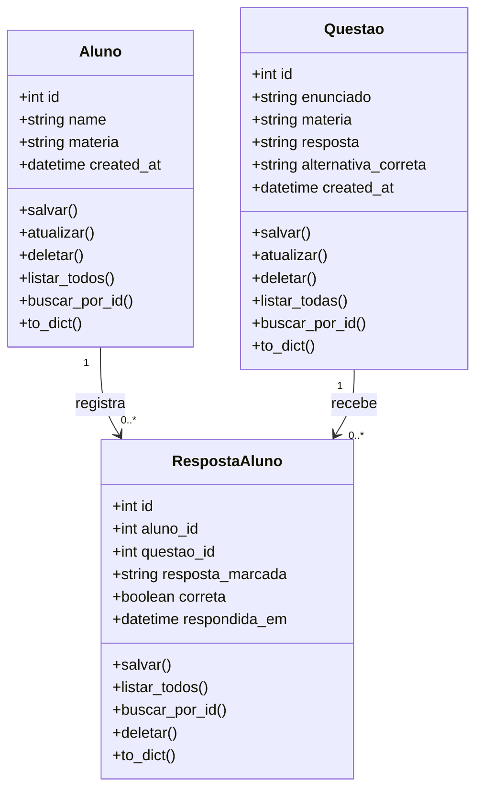

# Diagrama de classes do domínio

Cada `RespostaAluno` pertence a um aluno e a uma questão. A relação usa chaves estrangeiras; a exclusão de um aluno ou questão remove as respostas associadas por cascata. Não há herança entre as entidades do domínio.
